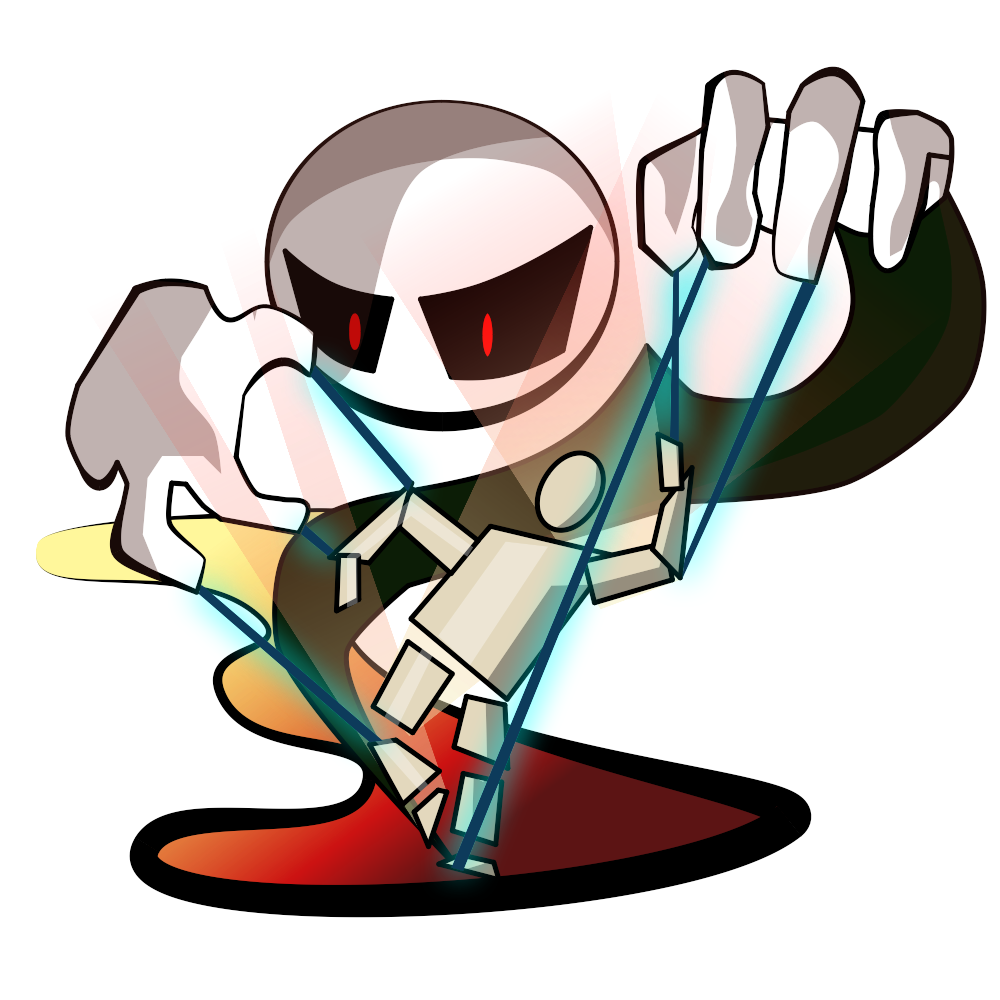

<p align="center">
  
</p>

<h1 align="center">SAM - Stickman Animation Maker</h1>

<p align="center">
  Frame-by-frame stick figure animation for Windows.<br>
  Draw and rig a figure, pose it frame by frame, then export a video.
</p>

<p align="center">
  <a href="https://github.com/MvRicciutelli/SAM-Stickman-Animation-Maker/releases/latest/download/SAM-Setup.exe">
    
  </a>
</p>

<p align="center">
  Free for personal use · Windows 10 and 11 (64-bit) ·
  <a href="https://github.com/MvRicciutelli/SAM-Stickman-Animation-Maker/releases">all versions and what's new</a>
</p>

## How to install

1. Click the green **Download SAM** button above. Your browser saves `SAM-Setup.exe`.
2. Open the downloaded file. You don't need administrator rights.
3. If Windows shows **"Windows protected your PC"**, click **More info**, then
   **Run anyway**. Windows shows this for any program that isn't code-signed by a paid
   certificate, not because something is wrong with it.
4. Follow the installer, then start SAM from the Start menu.

SAM checks for new versions when it starts and offers to open the download page when one
is out.

---

## Features

**Drawing**
- Ten kinds of stick: line, rectangle, circle, taper, trapezoid, polygon, multi-line
  (with a width per vertex), image, freehand raster painting and text.
- Any stick can be converted to any other kind in place.
- Fills and borders can be solid colours, linear or radial gradients, patterns (Photoshop
  `.pat` files or folders of PNG/JPG tiles) or your own images. An on-canvas handle lets you
  aim and scale a texture.
- Borders can be stamped with a brush tip instead of a pen. You can use Photoshop `.abr`
  brushes, import Krita `.bundle` brushes or save your own.
- Comes with free brush and pattern packs (all CC0, see [NOTICE.md](NOTICE.md) for credits).

**Rigging**
- Each figure is a tree of sticks: moving a stick carries its children with it.
- Inverse kinematics chains, a selectable master node, join/split of figures, horizontal
  and vertical flip.

**Animating**
- Frame-by-frame posing, with faded onion skins of as many previous frames as you choose.
- Generates inbetween frames between two keyframes.
- One layer per figure, plus per-stick depth ordering.
- Copy and paste a single frame or a whole block of frames.
- Undo/redo, autosave and playback preview.
- Figure libraries: store figures once and drop them into any scene.

**Import and export**
- Imports and exports Pivot Animator `.stk` figures (Pivot 2 and Pivot 5) and Stick Nodes
  `.nodes` figures. Those formats have no gradients or textures, so exported fills become
  flat colours.
- Exports a PNG image sequence, or an MP4 or AVI video out of the box.
- Point the export dialog at your own FFmpeg install to also get WMV and animated GIF.

## Requirements

- Windows 10 or 11, 64-bit.
- FFmpeg is optional and is never bundled. It is only needed for WMV and GIF export.

## Installing

The installer (see [How to install](#how-to-install)) works for the current user only,
so it needs no administrator rights, and puts the program in `%LOCALAPPDATA%\Programs\SAM`.

On first launch SAM creates its working folder in `Documents\SAM`:

| Folder              | Contents                                   |
|---------------------|--------------------------------------------|
| `myAnimations`      | your animations (`.sam`)                   |
| `myStickFigures`    | single saved figures (`.stck`)             |
| `Libraries`         | figure libraries (`.samlib`)               |
| `Brushes`           | brush tips (`.abr`, `.mbrush`)             |
| `myPatterns`        | pattern packs (`.pat`, folders of images)  |
| `myExportedVideos`  | default destination for video export       |

Uninstalling leaves this folder alone.

## File formats

| Extension | What it is                                                            |
|-----------|-----------------------------------------------------------------------|
| `.sam`    | a whole animation                                                     |
| `.samlib` | a library of figures                                                  |
| `.stck`   | one figure, native format                                             |
| `.stk`    | one figure, Pivot Animator (import/export)                            |
| `.nodes`  | one figure, Stick Nodes (import/export)                               |
| `.mbrush` | your own saved brush tips                                             |
| `.abr`    | Photoshop brushes (read only)                                         |
| `.pat`    | Photoshop patterns (read only)                                        |

`.mAnim` and `.marlib` files from MarionettaPlus, SAM's former name, open unchanged.

## Building from source

SAM is a qmake project. It is built with **Qt 6.6.1, MinGW 64-bit** (the kit Qt's
online installer calls *Desktop Qt 6.6.1 MinGW 64-bit*).

**Qt Creator:** open `SAM.pro`, pick the MinGW 64-bit kit and build.

**Command line:** build in a folder next to the source checkout, not inside it:

```powershell
$env:PATH = "C:\Qt\6.6.1\mingw_64\bin;C:\Qt\Tools\mingw1120_64\bin;$env:PATH"
mkdir ..\build-SAM-Release; cd ..\build-SAM-Release
qmake ..\<checkout>\SAM.pro -spec win32-g++
mingw32-make -f Makefile.Release -j8
```

The program is `release\SAM.exe`. Run `windeployqt release\SAM.exe` to copy the Qt
runtime next to it if you want to run it outside Qt Creator.

### Installer

```powershell
powershell -ExecutionPolicy Bypass -File installer\build-installer.ps1
```

This builds Release, stages the program with its Qt and MinGW runtime and compiles
`installer\out\SAM-<version>-setup.exe` with [Inno Setup 6](https://jrsoftware.org/isinfo.php),
plus an identical `SAM-Setup.exe`. That fixed-name copy is the one to attach to a GitHub
release: the Download button above links to `releases/latest/download/SAM-Setup.exe`.
Add `-SkipInstaller` to stop after staging: `installer\out\app` is then a portable
folder. Anything placed in `installer\content\` (brushes, patterns, libraries,
figures) is copied into the user's `Documents\SAM` on install, without overwriting
files already there.

The version number comes from `VERSION` in `SAM.pro`. The About box and the window
title carry their own copy of it and must be updated by hand.

### Tests

`tests/tests.pro` is a QtTest suite covering the data model, undo/redo, file
formats and rendering:

```powershell
mkdir ..\build-tests; cd ..\build-tests
qmake ..\<checkout>\tests\tests.pro
mingw32-make -f Makefile.Release compiler_moc_source_make_all
mingw32-make -f Makefile.Release
$env:QT_QPA_PLATFORM = "offscreen"; .\release\tst_characterization.exe
```

Run the `compiler_moc_source_make_all` step whenever a test is added. Without it the
new test is silently left out. Under the `offscreen` platform no fonts are available,
so the text-rendering test is skipped.

Architecture and design notes are in [CLAUDE.md](CLAUDE.md).

## License

Copyright (C) 2026 Matteo Vittorio Ricciutelli.

SAM is **source-available, not open source**. It is free for personal, hobby,
educational and other noncommercial use under the
[PolyForm Strict License 1.0.0](LICENSE). The animations, images and videos you make
with it are yours, including for commercial use.

Redistributing SAM or modifying it requires the author's written permission. To
request it, or to propose a contribution, write to matteoricciutelli(at)mail.com.
The full terms are in [LICENSE](LICENSE). It also lists the extra permissions that
apply to the Qt libraries.

SAM is built with [Qt](https://www.qt.io), dynamically linked under the LGPLv3.
Third-party notices, including the Qt and FFmpeg terms, are in [NOTICE.md](NOTICE.md)
and the [LICENSES](LICENSES) folder.
